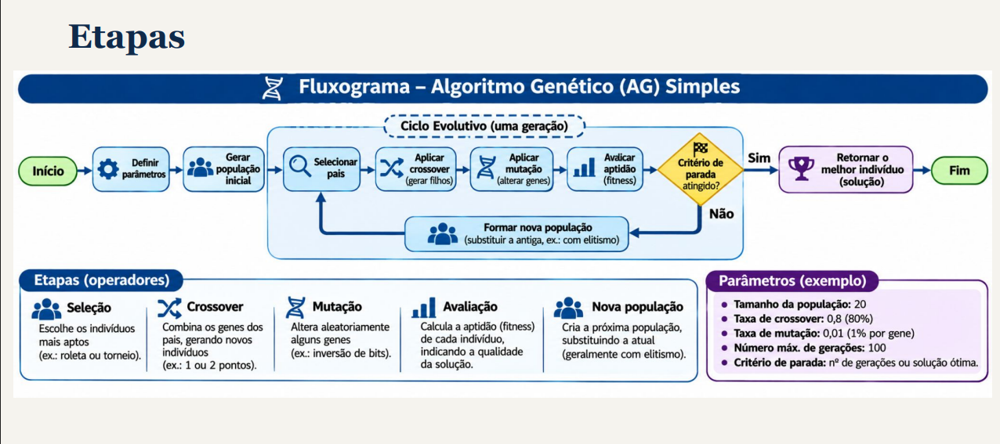

# Algoritmos genéticos

## Sumário

- [O que são algoritmos genéticos?](#o-que-são-algoritmos-genéticos)
- [Implementação geral](#implementação-geral)
- [Etapas do algoritmo genético](#etapas-do-algoritmo-genético)
- [Técnicas para melhorar eficiência do algoritmo](#técnicas-para-melhorar-eficiência-do-algoritmo)
- [Tipos de Algoritmos genéticos](#tipos-de-algoritmos-genéticos)
- [Glossário](#glossário)

## O que são algoritmos genéticos?

Algoritmos genéticos são práticas para solucionar problemas de análise combinatória complexos em algoritmos com lógica similar a uma forma que a genética funciona

### Implementação geral

A forma que ela é implementada depende especialmente de qual é o problema que espera-se ser solucionado. Portanto, a aplicação destes algoritmos são personalizadas de acordo com o problema que se busca solucionar.

Para um algoritmo ser genético, é necessário que ele possua os seguintes elementos:
- Uma população¹ inicial;
- Que cada indiviuo² seja analisado individualmente e convertido em um cromossomo³;
- Possuir um critério de parada de acordo com a aptidão⁴ do indivíduo analisado.
Enquanto o critério não for alcançado, deve ser feito:  
    - Realizar o crossover⁵ e mutações⁶;
    - Manter as características dos individuos mais aptos nas combinações posteriores;
    - Armazenar esses indivíduos cruzados/mutados como uma nova população;
    - Refazer a análise de cada indivíduo dessa nova população;

### Etapas do algoritmo genético

### Técnicas para melhorar eficiência do algoritmo

Para melhorar um algoritmo genético e alcançar o resultado ótimo de forma mais eficiente (ou então, o mais próximo do ótimo), existem duas técnicas que podem ser usadas:

- **Elitismo**: Crossover e mutação podem destruir o melhor indivíduo. O elitismo copia o melhor para a geração seguinte, mantendo as características com maior aptidão nas seguintes gerações;

- **Técnicas de parada**: cada problema vai necessitar de uma técnica de parada diferente para conseguir um resultado de forma mais rápida, gastando menos recursos ou mais próximo do ótimo. Algumas dessas técnicas são de acordo com: Número de gerações; solução encontrada (quando conhecida); perda de diversidade; convergência (sem melhora da aptidão nas últimas k gerações).

## Tipos de Algoritmos Genéticos

Existem vários tipos de algoritmos genéticos que possuem estruturas diferentes para determinados casos. O caso utilizado deve ser escolhido de acordo com o problema, que também permite a mesclagem de dois ou mais algoritmos. Alguns exemplos são:
- **Caixeiro Viajante (TSP)**: Encontrar a rota de menor distância que visita todas as cidades e retorna à origem.
- **Mochila 0/1 (Knapsack)**: Escolher quais itens irão para a mochila com capacidade limitada, buscando maximizar o lucro dos itens selecionados, respeitando a capacidade da mochila.
- **Coloração de Grafos**: Minimizar a quantidade de cores utilizadas, evitando conflitos entre vértices adjacentes.
- **Funções de Benchmark**: Encontrar o mínimo global das funções Sphere, Rastrigin e Rosenbrock.

### Base de Dados
As bases de dados utilizadas para estas analises foram:

| Problema | Repostitório | Exemplos
| --- | --- | --- | 
| Caixeiro Viajante (TSP) | https://comopt.ifi.uni-heidelberg.de/software/TSPLIB95/tsp/tspindex.html| eil51, berlin52, st70, eil76, kroA100
| Mochila 0/1 | https://people.sc.fsu.edu/~jburkardt/datasets/knapsack_01/knapsack_01.html | Cinco instâncias com diferentes quantidades de itens e capacidades
| Coloração de Grafos | https://mat.tepper.cmu.edu/COLOR/instances.html | myciel3, myciel4, myciel5, myciel6, myciel7

## Funções de Benchmark

As funções utilizadas para calcular o benchmarek são:

| Função | Equação | Solução ótima | Valor mínimo |
| --- | --- | --- | --- |
| Sphere (1D) | 𝑓(𝑥) = 𝑥² | 𝑥* = 0 | 0 |
| Rastrigin (1D) | 𝑓(𝑥) = 10 + 𝑥² − 10 cos(2π𝑥) | 𝑥* = 0 | 0 |
| Rosenbrock (2D) | 𝑓(𝑥₁, 𝑥₂) = 100(𝑥₂ − 𝑥₁²)² + (1 − 𝑥₁)² | 𝑥₁* = 1, 𝑥₂* = 1 | 0 |

### Representação dos Cromossomos

As funções deverão utilizar cromossomos com representação binária.
- **Sphere e Rastrigin**: O cromossomo deverá representar uma única variável (por exemplo: 𝑥).
- **Rosenbrock**: O cromossomo deverá representar obrigatoriamente duas variáveis (por exemplo: 𝑥₁ e 𝑥₂).

Por exemplo (para a função Rosenbrock), utilizando 10 bits para cada variável:

### Conversão de valores binários para reais 
Para utilizar um Algoritmo Genético na otimização de funções matemáticas, é necessário converter o cromossomo binário em um valor real dentro do intervalo de busca definido.

A conversão é realizada pela fórmula:

$$
\begin{cases}
x = - a + \frac{d}{2^n - 1} . (b - a)
\end{cases}
$$

Onde:
- 𝑎: limite inferior do intervalo.
- 𝑏: limite superior do intervalo.
- 𝑑: valor decimal do cromossomo binário.
- 𝑛: quantidade de bits do cromossomo.
- 𝑥: valor real obtido.

## Algoritmos Utilizados

## Bases de Dados Utilizados 

## Resultado dos Experimentos 

## Glossário
**População¹**: o conjunto de dados que serão analisados. Ele depende do tipo de indivíduo que será analisado e do tipo de dado que pertence a população. Por exemplo: um dicionário pode ser uma população, desde que os indivíduos sejam cada valor dentro deste dicionário, mas um valor int, float, double, etc. não pode ser uma população. Uma população pode ter indivíduos com tipagens diferentes entre si, embora não seja uma boa prática.

**Indivíduo²**: Um elemento que será feito as análises e mutações/crossovers. Ele pode ser qualquer tipo de dado, desde que existam outros indivíduos onde ele não englobe os outros. Por exemplo: um int, float, double, string são indivíduos em todos os casos. Entretanto, uma lista ou dicionário pode ser um indivíduo desde que a população tenha outras listas e dicionários semelhantes a eles.

**Cromossomo³**: estrutura de dados que representa uma solução, ou seja, a decomposição do indivíduo em um valor significativo (vetor de reais, de inteiros, cadeia de bits)

**Aptidão⁴**: nota que avalia quão boa é a solução; pode ser a própria função objetivo (que determina o ponto de parada) ou basear-se no ranking de elementos mais condizentes com a solução ideal.

**Crossover⁵**: é o cruzamento de cromossomos de um indivíduo com outro, normalmente feito ao cortar um vetor em duas ou mais partes e gerar dois novos indivíduos com as partes dos indivíduos pais cruzadas entre si.

**Mutações⁶**: é o ato de alterar aleatóriamente um nos elementos do cromossomo. Ele deve ser feito na medida correta, pois mutar um indivíduo o tempo todo faz com que as características boas dos pais que gera uma alta aptidão sejam perdidos, mas nunca usar pode fazer com que o algoritmo fique preso e longe do resultado ideal.